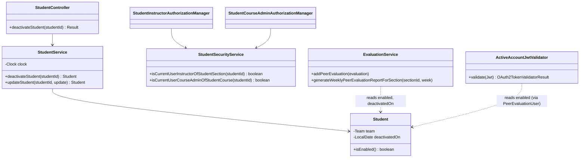
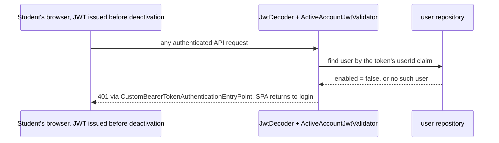

# **Student Design**

> Realizes: UC-STU-deactivate-student
> Depends on FRs: FR-SEC-active-account, FR-SEC-authorization
> Rules: BR-student-lifecycle, BR-section-scoped-access, BR-submission-owed, BR-team-scoped-access
> See: [use cases](../requirements/use-cases.md#uc-stu-deactivate-student-the-course-admininstructor-deactivates-a-student), [SRS](../requirements/software-requirements-specification.md), [architectural-design.md](architectural-design.md) (Container diagram, JWT/`AuthorizationManager` conventions)

## **Overview**

The `student` slice (`backend/src/main/java/team/projectpulse/student/`) owns a student's account. Deactivation turns the account off without removing the student from her team or her work. Three other slices must then treat her as inactive: security refuses her requests, `evaluation` stops teammates from evaluating her and drops her from the course section's report from her deactivation week on, and `notification` already skips her. This doc covers deactivation only. Reactivation is designed when UC-STU-reactivate-student is designed; that use case's Associated Information lists the constraints it inherits from here.

## **Components & classes**



| Component | File | New / changed |
|---|---|---|
| Endpoint + service method | `student/StudentController.java`, `student/StudentService.java` (`Clock` injected as in `evaluation/EvaluationService.java`) | new method; `updateStudent` stops changing `enabled` |
| Entity + migration | `student/Student.java`, `db/migration/V7__student_deactivated_on.sql` | new column |
| Route rule | `security/SecurityConfiguration.java`, `student/StudentSecurityService.java`, new `security/authorizationmanagers/StudentCourseAdminAuthorizationManager.java`; reuses `StudentInstructorAuthorizationManager` | new rule |
| Active check on every request | new `security/ActiveAccountJwtValidator.java`, wired into `SecurityConfiguration.jwtDecoder()` | new, shared trunk |
| Peer evaluation | `evaluation/EvaluationService.java` | changed guard and report filter |
| Reminders | `notification/SubmissionStatusService.findOwedItems` already filters `isEnabled()` | reused, unchanged |
| Frontend | `apis/student` (`deactivateStudent`), `pages/students/Students.vue` (Deactivate button + `ElMessageBox.confirm`), `pages/students/EditStudentForm.vue` (Status item removed), the peer-evaluation submission page (lists only `enabled` teammates) | changed |

## **Sequence**

### *UC-STU-deactivate-student*

```mermaid
sequenceDiagram
  actor I as Instructor or course admin
  participant SPA as Students.vue
  participant SC as SecurityConfiguration rule
  participant C as StudentController
  participant S as StudentService
  participant DB as MySQL
  I->>SPA: Deactivate on an active student's row (step 3; not offered when inactive, 3a)
  SPA->>I: Warning with the consequences, asks to confirm (step 4)
  alt Cancel (5a)
    SPA-->>I: Dialog closes, no request sent
  else Confirm (step 5)
    SPA->>SC: PUT /students/{studentId}/deactivation
    SC-->>SPA: 403 No permission (6b: not her section instructor or course admin, or unknown id)
    SC->>C: allowed
    C->>S: deactivateStudent(studentId)
    S->>DB: load student
    S-->>C: already inactive: INVALID_ARGUMENT (6a), date untouched
    S->>DB: enabled = false, deactivatedOn = LocalDate.now(clock), team untouched
    C-->>SPA: SUCCESS + StudentDto (step 6)
  end
```

### *A deactivated student's next request (FR-SEC-active-account)*



## **API contract**

| Endpoint or job | Caller (who may) | Request | Success | Errors, by extension |
|---|---|---|---|---|
| `PUT /students/{studentId}/deactivation` | instructor assigned to the student's course section, or course admin of her course; never the student herself | path id only, no body | `SUCCESS`, the updated student (`enabled` false) | 6a: `INVALID_ARGUMENT` "This student is already deactivated."; 6b: 403 "No permission." |
| every authenticated route | — | bearer JWT whose user is deactivated or gone | — | 401 (FR-SEC-active-account) |
| `POST /evaluations` (changed) | student | an evaluatee who is deactivated | — | UC-EVA-submit-evaluation 5a: `INVALID_ARGUMENT` "A deactivated teammate is not evaluated." |
| `GET /evaluations/sections/{sectionId}/week/{week}` (changed) | unchanged | unchanged | omits a student whose deactivation week is on or before `week` | — |
| `PUT /students/{studentId}` (changed) | unchanged | `enabled` is ignored | unchanged | — |

## **Key decisions**

- **A dedicated endpoint, and the old path is removed.** Rejected: keeping `enabled` in `PUT /students/{studentId}`, because that route's rule (`userOwnershipAuthorizationManager`) also admits the student herself, and the route bypasses the warning and the deactivation date. Two ways to deactivate would carry two sets of rules.
- **The route rule is `anyOf(StudentInstructorAuthorizationManager, StudentCourseAdminAuthorizationManager)`.** This states BR-student-lifecycle directly. Rejected: reusing `userOwnershipAuthorizationManager`, which admits the student and refuses a course admin who is not assigned to the course section. An unknown id fails closed as 403, following the `StudentSecurityService` convention, which is why extension 6b covers both cases.
- **The active check runs in the JWT decoder's validator chain** (`DelegatingOAuth2TokenValidator` of the default validators plus `ActiveAccountJwtValidator`). A failed check becomes an invalid token, and the existing bearer entry point answers 401. Rejected: a `OncePerRequestFilter`, which would need its own 401 wiring; a token revocation list, which adds state for the same effect; and a shorter token lifetime, which still leaves a gap. Cost: one primary-key read per authenticated request, accepted.
- **She stays on her team, and the system records `deactivatedOn` as a date from the injected `Clock`.** The report week is derived from it with `system/WeekKeys`. Rejected: removing her from the team, because `Team.removeStudent` nulls `Student.team`, which drops every past week from the report and orphans her work from her team. Rejected: storing a week key, because the date is the fact and the week is derived from it. The column lives on `Student` only, because instructors don't need it yet.
- **Deactivating an already-deactivated student is an error and keeps the original date.** Rejected: idempotent success, because overwriting the date would shift which weeks she appears in, and an error tells a stale page that it is stale.
- **Authorization is a route rule (403); "already deactivated" is a service check.** The service check names the violation, following the OI-49 precedent for domain preconditions.

## **Data model**

Delta to the SRS Business Domain Model: `student.deactivated_on DATE NULL` (`V7__student_deactivated_on.sql`). It is null for every active student. A student disabled before this migration also keeps null, so she appears in the report for every week.

## **Tests**

| # | Flow | Level | Asserts |
|---|---|---|---|
| T1 | Main success scenario | integration | the course section's instructor deactivates an active student: `SUCCESS`, `enabled` false, team unchanged, `deactivatedOn` is the clock's date |
| T2 | Main success scenario | unit (`StudentServiceTest`) | `deactivateStudent` sets `enabled` false and the date from a fixed `Clock`, and leaves the team unchanged |
| T3 | Main success scenario, course admin | integration | the course admin of the student's course, not assigned to her course section, may deactivate her |
| T4 | 3a | manual E2E | the Deactivate button is absent on an inactive student's row |
| T5 | 5a | manual E2E | Cancel in the dialog sends no request, and the student stays active |
| T6 | 6a | unit + integration | a second deactivation returns `INVALID_ARGUMENT`, and `deactivatedOn` is unchanged |
| T7 | 6b | integration | an instructor not assigned to her course section gets 403; the student herself gets 403; an unknown id gets 403 |
| T8 | Associated Information: logged-in student (FR-SEC-active-account) | integration | a token obtained before deactivation is refused with 401 on the next request, and a fresh login is refused |
| T9 | BR-student-lifecycle: not evaluated (UC-EVA-submit-evaluation 5a) | unit (`EvaluationServiceTest`) + integration | an evaluation of a deactivated evaluatee is rejected |
| T10 | BR-student-lifecycle: report weeks | unit (`EvaluationServiceTest`) | a student deactivated in week W appears in the report for week W-1 and is omitted from week W |
| T11 | Old path removed | integration | `PUT /students/{studentId}` with `enabled` false leaves her active |

## **Reuse & cross-cutting**

- Authorization: the existing `AuthorizationManager` + `StudentSecurityService` pattern (FR-SEC-authorization).
- Login refusal: `MyUserPrincipal.isEnabled` already rejects a disabled account at login, through the `AccountStatusException` handler.
- Reminders and who owes what: `SubmissionStatusService` (`not.md`) already applies BR-submission-owed's active filter.
- Week arithmetic: `system/WeekKeys`.
